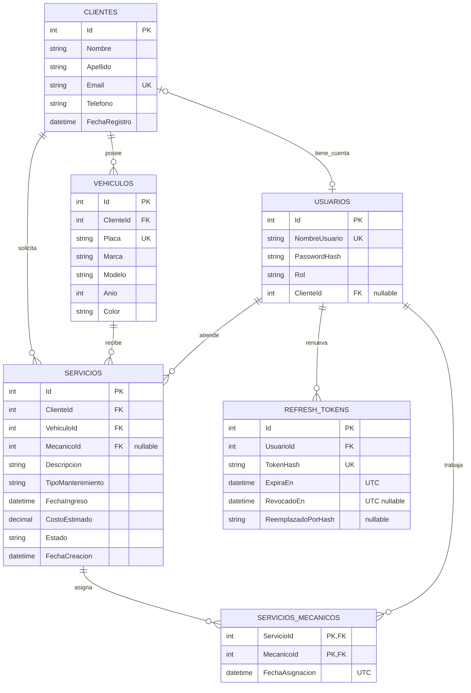

# Informe técnico — AutoFix Manager

## 1. Descripción del sistema

AutoFix Manager apoya la operación de un taller automotriz mediante la administración de clientes, vehículos y órdenes de servicio. Mantiene historial de mantenimiento y controla qué información puede consultar cada tipo de usuario. La interfaz React consume una API REST ASP.NET Core; la información se persiste en MySQL con Entity Framework Core.

## 2. Alcance y correspondencia con los requisitos

La adaptación conserva el contexto real del proyecto (taller) en lugar de sustituirlo por un gimnasio:

| Requisito de referencia | Equivalente en AutoFix Manager |
|---|---|
| Socios | Clientes |
| Entrenadores | Mecánicos |
| Membresías / plan | Órdenes e historial de servicio |
| Asistencia | Registro y actualización de órdenes de trabajo |
| Historial del socio | Historial de servicios del cliente |
| Plan de entrenamiento | Servicios y trabajos asociados a los vehículos del cliente |

## 3. Arquitectura y persistencia

- **Presentación:** React + Vite, con pantallas distintas por rol.
- **API:** ASP.NET Core .NET 10, controladores, DTOs con validaciones y documentación Swagger.
- **Aplicación:** servicios de clientes, vehículos y órdenes; repositorio genérico EF Core.
- **Datos:** MySQL, `AutoFixDbContext`, claves foráneas, índices, relación muchos-a-muchos y procedimiento almacenado.
- **Seguridad:** JWT de acceso sin sesión, refresh token rotatorio en cookie `HttpOnly`, autenticación Bearer y autorización por roles.
- **Errores:** middleware centralizado que clasifica restricciones SQL conocidas, registra fallos y evita exponer detalles internos.

Ejecuta `database/script-autofixmanager.sql` en MySQL Workbench para crear `AutoFixManagerDb`. Las instrucciones de configuración local, Docker, Scaffold y ejecución están en `README.md`.

## 4. Diagrama entidad-relación

Una orden tiene cliente y vehículo obligatorios; el servicio valida que el vehículo pertenezca a ese cliente. `MecanicoId` conserva el mecánico responsable por compatibilidad y `ServiciosMecanicos` registra al equipo completo, con clave compuesta y fecha de asignación. Una cuenta `CLIENTE` se asocia a un único registro de cliente. Los refresh tokens se almacenan como hashes y la columna de reemplazo conserva el enlace de rotación.

## 5. Seguridad y autorización

El login genera un JWT de acceso firmado con HMAC-SHA256 (15 minutos por defecto), con identificador de usuario, nombre, rol y `clienteId` cuando corresponde. La API valida firma, emisor, audiencia y vigencia. El refresh token aleatorio tiene vigencia predeterminada de 7 días, se entrega solo mediante cookie `HttpOnly` y se rota de forma atómica; la base de datos conserva SHA-256, expiración, revocación y reemplazo. No se almacenan contraseñas en texto plano; se usa `PasswordHasher<Usuario>`.

| Rol | Operaciones |
|---|---|
| `ADMIN` | CRUD de clientes, vehículos y órdenes; crea/lista usuarios y asigna mecánicos a órdenes. |
| `MECANICO` | Consulta clientes, vehículos y servicios asociados a sus órdenes; crea órdenes asignadas a sí mismo y actualiza únicamente sus órdenes. El filtro personalizado oculta órdenes no asignadas como 404. |
| `CLIENTE` | Consulta sus vehículos e historial de servicios, filtrados por el identificador de cliente contenido en el JWT. |

El middleware JWT devuelve `401` sin token o con token inválido y `403` cuando el usuario autenticado no tiene el rol requerido. `POST /api/auth/refresh` rota la cookie y `POST /api/auth/logout` revoca el refresh token actual.

## 6. Validaciones y manejo de errores

Los DTOs validan campos requeridos, formatos, longitudes, rangos y valores permitidos. Las reglas de negocio verifican relaciones cliente/vehículo, existencia de mecánicos, tamaño del equipo asignado, propiedad de órdenes, duplicados y conflictos de borrado. El middleware traduce errores SQL conocidos (duplicados, FK, valores faltantes o fuera de rango y bloqueos) a HTTP apropiados, registra fallos y no expone mensajes internos.

## 7. Guion de pruebas Postman

Colección: `postman/AutoFixManager.postman_collection.json`.

1. Iniciar API y MySQL, importar la colección y usar `baseUrl = http://localhost:8080`.
2. Ejecutar `Login ADMIN` y `Renovar JWT ADMIN`; comprobar HTTP 200 y que Postman conserva/renueva la cookie HttpOnly.
3. Sin token, consultar `/api/clientes`: esperado HTTP 401.
4. Crear cliente, vehículo, dos mecánicos y una orden asignada a ambos; verificar HTTP 201 y captura de IDs.
5. Repetir correo o placa: esperado HTTP 409. Enviar DTO inválido: HTTP 400. Consultar ID inexistente: HTTP 404.
6. Crear usuario `MECANICO` y asignarle una orden desde ADMIN. Iniciar sesión como mecánico: debe poder consultar `/api/mecanico/mis-clientes`, `/mis-vehiculos` y `/mis-servicios`, pero no `/api/clientes` global (HTTP 403). Una orden de otro mecánico no se puede consultar ni actualizar.
7. Crear usuario `CLIENTE` asociado al cliente de prueba. Iniciar sesión como cliente: `/api/portal/mis-vehiculos` y `/mis-servicios` solo contienen sus datos; `/api/servicios` devuelve HTTP 403.
8. Comprobar borrado de vehículo con órdenes asociadas: esperado HTTP 409.
9. Consultar `/api/reportes/servicios/estado` como ADMIN; debe devolver los agregados obtenidos por `sp_ResumenServiciosPorEstado`.

### Evidencias

La colección se ejecutó con Newman el 22-11-2026 contra una instancia MySQL temporal aislada:

| Resultado | Valor |
|---|---:|
| Solicitudes | 56 |
| Aserciones | 62 |
| Fallos | 0 |

La ejecución verificó inicio de sesión y refresh rotatorio, acceso sin token (401), restricciones por rol (403), operaciones CRUD, errores de validación y conflictos (400/404/409), relación muchos-a-muchos, portales de mecánico y cliente, y el reporte mediante `sp_ResumenServiciosPorEstado`. La salida de Newman fue la evidencia de ejecución; no se tomaron capturas de Postman Desktop. Para repetir la prueba, consulta el comando Newman y los pasos de configuración de MySQL en `README.md`. La prueba temporal no sustituye una validación de despliegue en el servidor MySQL final del usuario.

## 8. Ejecución y estado de publicación

Seguir `README.md` para ejecutar MySQL, backend, frontend y colección Postman. La compilación .NET y la compilación de producción del frontend se verificaron. La ejecución funcional de la colección también se verificó con Newman contra una instancia MySQL temporal aislada (56 solicitudes, 62 aserciones, 0 fallos); debe repetirse con las credenciales y la instancia definitivas del despliegue.

**Repositorio con acceso de lectura para el docente:** pendiente de publicar. Este espacio de trabajo no tiene remoto Git configurado. Publicar la carpeta del proyecto en GitHub u otra plataforma, conceder permiso de lectura y reemplazar este texto por el enlace definitivo.
